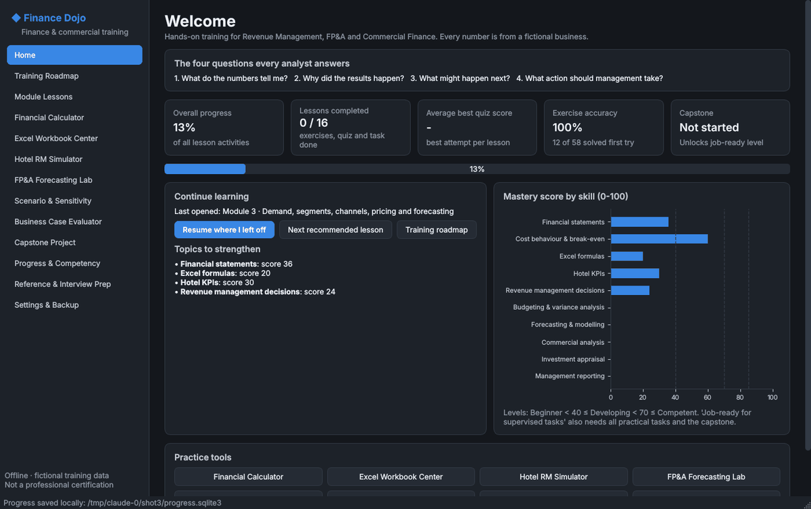
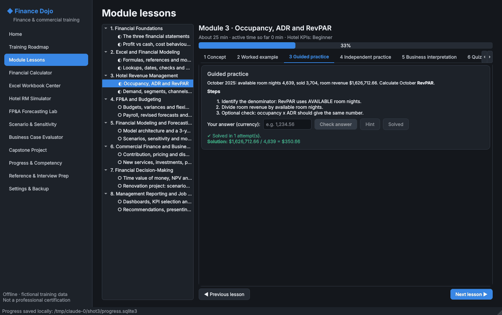
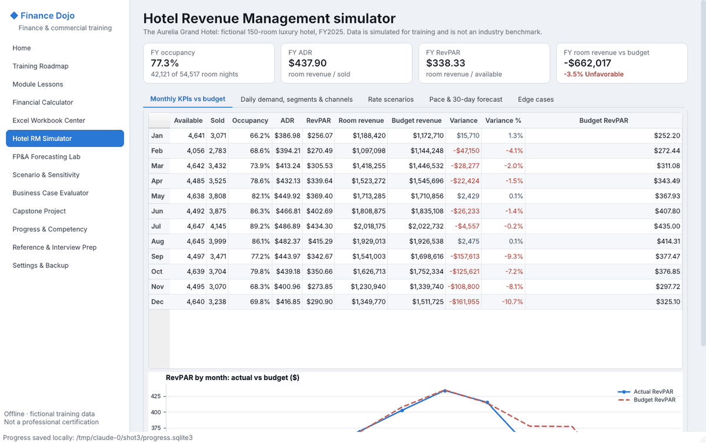
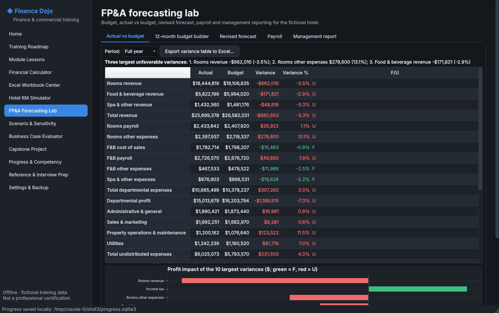
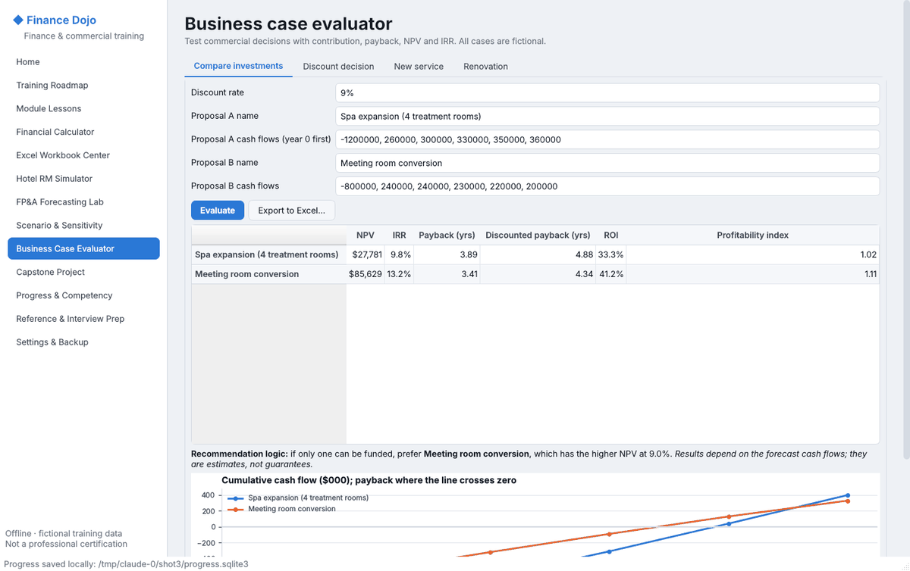
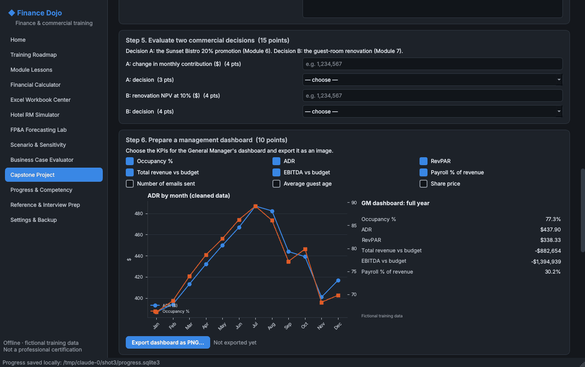
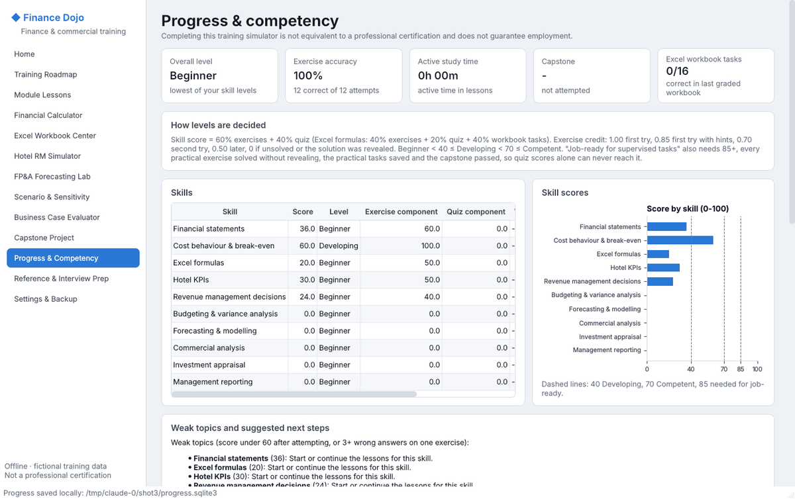

<div align="center">


# Finance Dojo

**A hands-on Windows desktop course for Revenue Management, FP&A and Commercial Finance. You learn by building, checking and explaining real analyses.**

[](https://github.com/mutima89/finance-dojo/actions/workflows/windows.yml)

-41CD52?logo=qt&logoColor=white)




</div>

---

## Why this exists

Many finance graduates know the theory but have rarely built a model, reconciled a budget or defended a recommendation. This simulator closes that gap with short lessons, realistic (fictional) data and instant feedback. Every exercise trains the four questions an analyst is paid to answer:

> **1.** What do the numbers tell me? **2.** Why did the results happen? **3.** What might happen next? **4.** What action should management take?

The main case study is **The Aurelia Grand**, a fictional 150-room luxury hotel. A fictional retailer and several small commercial projects provide extra practice.

## Features

- **8 modules and 16 lessons.** Each lesson follows Concept → Worked example → Guided practice → Independent practice → Business interpretation → Quiz → Practical task.
- **58 auto-checked exercises.** Answers are accepted within sensible tolerances (`75%`, `0.75` and `75` are all accepted). Feedback names the exact mistake, such as dividing by sold instead of available rooms, a sign error or a ×100 scale error. Hints are given on request, and the worked solution appears after a configurable number of attempts.
- **Excel Workbook Center.** Generate a practice `.xlsx` with raw data, assumptions and 16 formula tasks (SUMIFS, IF, IFERROR, INDEX/MATCH or XLOOKUP, dates, fill-down). Do the work in Excel, then let the app grade your saved file. A built-in Formula Lab offers the same tasks without Excel.
- **Hotel RM Simulator:**
  - occupancy, ADR and RevPAR against budget;
  - weekday/weekend demand, segments and channels;
  - rate scenarios with price elasticity;
  - booking pace and a 30-day forecast;
  - data-quality edge cases (zero sold rooms, zero available rooms, cancellations, missing data).
- **FP&A Lab:** actual vs budget with favorable/unfavorable (F/U) flags, the top-3 unfavorable variances, a 12-month budget builder, revised forecasts, payroll analysis and a one-page management report.
- **Scenario & sensitivity:** a 3-year hotel driver model (operations → EBITDA → free cash flow → cash) with base, upside and downside scenarios, a sensitivity grid and model checks.
- **Business Case Evaluator:** NPV, IRR, payback, ROI and profitability index; discount decisions; a new service; a renovation project with a break-even uplift.
- **Capstone:** clean messy data, calculate KPIs, forecast, explain variances, evaluate two decisions, build a dashboard, write an executive recommendation and face a simulated management meeting. Scored with a transparent 100-point rubric.
- **Honest progress tracking:**
  - skill levels from *Beginner* to *Job-ready for supervised tasks*;
  - job-ready **requires the practical tasks and a passed capstone**, never quiz scores alone;
  - weak-topic detection, active study time and exportable competency reports (HTML or Excel).
- **Reference:** a searchable glossary (54 terms), formula sheet (28), common mistakes (18) and interview questions with model answer outlines (20).
- **Dark and light themes**, local SQLite progress with backup, restore and reset, and no accounts or internet needed.

## Screenshots

| | |
|---|---|
|  |  |
| **Guided practice** with step-by-step help and instant checking | **Hotel RM simulator:** monthly KPIs vs budget |
|  |  |
| **FP&A lab:** actual vs budget with F/U and the largest variances | **Business cases:** NPV, IRR, payback and ROI side by side |
|  |  |
| **Capstone:** build and export the GM dashboard | **Progress & competency:** transparent mastery rules |

## Download and run (Windows 10/11)

1. Open the **[Releases](https://github.com/mutima89/finance-dojo/releases)** page and download `Finance_Dojo_Windows.zip`. Every build of `main` is also available under **[Actions](https://github.com/mutima89/finance-dojo/actions/workflows/windows.yml)** → latest run → *Artifacts*.
2. Unzip it anywhere, then double-click `Finance_Dojo.exe`. Python is not needed.
3. The exe is not code-signed, so Windows SmartScreen may warn the first time. Click *More info → Run anyway*.

To check the installation, run `Finance_Dojo.exe --self-test`. It opens every screen in both themes and checks some calculations, then writes `%APPDATA%\Finance_Dojo\self_test_report.txt`.

## Build from source

**Windows (one command):** install [Python 3.12 (64-bit)](https://www.python.org/downloads/windows/) and tick *Add python.exe to PATH*. Then double-click **`build_windows.bat`**. It creates a virtual environment, installs the pinned packages, runs the tests, builds the exe with PyInstaller and self-tests it. The app ends up at:

```
dist\Finance_Dojo\Finance_Dojo.exe
```

**Any OS, for development:**

```bash
python3.12 -m venv .venv
.venv/bin/pip install -r requirements-dev.txt      # Windows: .venv\Scripts\pip
.venv/bin/python main.py                           # run the app
QT_QPA_PLATFORM=offscreen .venv/bin/python -m pytest -q   # 168 tests
```

On Linux without Windows you can still produce the Windows exe with Wine: `scripts/build_exe_with_wine.sh`.

## Testing

- **168 automated tests:**
  - every finance formula is checked against **hand-calculated** values (occupancy, ADR, RevPAR, variances, contribution, break-even, NPV, IRR, payback, forecast reconciliation and division by zero);
  - the fictional datasets are checked to reconcile (the balance sheet balances, and cash flow ties out);
  - the Excel grader and formula engine are tested, and the answer-key workbook is recalculated by LibreOffice;
  - mastery rules, persistence, and backup and restore are tested;
  - a headless UI test opens every screen and clicks every button.
- **CI:** every push is built and tested on `windows-latest` by GitHub Actions. That run covers the tests, the PyInstaller build and the exe's own `--self-test`.
- **Verification report:** [docs/VERIFICATION_REPORT.md](docs/VERIFICATION_REPORT.md) states exactly what was tested, where, and what was not.

## Project structure

```
main.py               entry point (python main.py, or --self-test)
fts/core/             calculations: metrics, forecasting, FP&A, answer checker, mastery rules
fts/data/             deterministic fictional data generator (seed 2025)
fts/excel/            .xlsx builder, grader and Excel formula engine
fts/content/          curriculum, quizzes, capstone, glossary and interview prep
fts/storage/          SQLite progress store with backup/restore
fts/reports/          Excel/HTML exports, competency report, answer key
fts/ui/               PySide6 main window, themes, widgets and the 12 screens
datasets/             generated CSV/JSON training data
workbooks/            practice workbook and instructor answer-key workbook
docs/                 user guide, answer key, troubleshooting, verification report, screenshots
tests/                pytest suite
scripts/              asset generator, icon, Wine build
build_windows.bat     reproducible Windows build (wraps build_windows.ps1)
```

## Documentation

| Document | For |
|---|---|
| [User guide](docs/USER_GUIDE.md) | Every screen, how answers are checked, mastery rules, where data is stored |
| [Instructor answer key](docs/ANSWER_KEY.md) | Every exercise, quiz, workbook task and capstone item, with working and common wrong answers |
| [Troubleshooting](docs/TROUBLESHOOTING.md) | Build and runtime problems |
| [Verification report](docs/VERIFICATION_REPORT.md) | What was tested, how, and the known limitations |

## Important notes

- **Fictional data:** all companies, hotels and figures are fictional training data. They are not real market data or industry benchmarks.
- **No guarantees:** forecasts and valuations in the app are illustrative estimates, never guarantees.
- **Excel:** the app creates and grades `.xlsx` files. It does **not** control or edit Microsoft Excel.
- **Not a certification:** completing the simulator is **not** a professional certification and does not guarantee employment.

## License

[MIT](LICENSE)

## Tech stack

Python 3.12 · PySide6 6.7 · pandas · NumPy · openpyxl · Matplotlib · SQLite · PyInstaller · pytest
